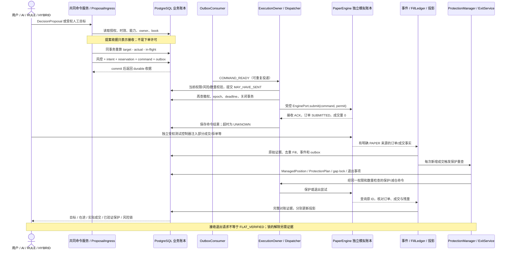

# 从目标仓位到成交与退出

本文对应 2026-10-27 工程任务 D，解释统一 PAPER 的应用契约。源码审阅基线为 `97c4f9d`；下图是目标组合，不能据此认定 Web/CLI 已全部接通或任务 C 已通过。当前控制台接线与可运行示例见文末；验收边界见 [acceptance.md](acceptance.md)。AI、RULE、HYBRID 和受权人工请求保持共同入口；Spot、USD-M、Stocks 的最终范围不变，各产品资格分别验证。

## 一笔交易走过哪些边界

图中命令服务是组合责任，不应产生第二个独立写入引擎入口。[ProposalIngress](../src/trading_system/intents/ingress.py) 将服务端 `DecisionContext`、部署 fence、owner、规则和证据绑定成不可变 `AcceptedProposal`；`VALIDATING` 收据尚未预留或执行。[ReservationService.reserve_proposal](../src/trading_system/risk/reservations.py) 读取这份 durable 提案，在 collateral 锁与管理 owner 锁下通过 [compile_locked](../src/trading_system/intents/target_compiler.py) 重新计算目标差量，再原子提交风控、intent、预留、command 和 outbox。

例如目标为 1，实际为 0，已有 0.4 durable 在途量时，不能再发 1。数量义务与资金预留分开；READY 命令立即占在途数量，UNKNOWN 不因超时消失，资金预留可能保守地高于剩余差量。终态订单标签、ACK 或一个 `released=true` 都不能替代完整成交/持仓对账。[TargetReportService](../src/trading_system/risk/target_guard.py) 验证精确归档字节、订单、去重成交与实际持仓的关系。旧提案在人工改仓后必须重新绑定当前账本，不能自动补回旧目标。

[CommandDispatcher](../src/trading_system/execution/dispatcher.py) 由 [ExecutionOwner](../src/trading_system/runtime/execution_owner.py) 的互斥 guard 约束。先把 `MAY_HAVE_SENT` 提交到业务库，再重新验证，关闭业务事务后才调用 EnginePort。一次本地异常也不能证明未发送；恢复查询原 logical/client order ID。[OutboxConsumer](../src/trading_system/execution/outbox.py) 的投递收据不是发送许可，只有持久结果才可确认消费。

[PaperEngine](../src/trading_system/engine/paper.py) 的提交只创建零成交的 `SUBMITTED`，不会依据当前价格自动成交。`SyntheticOrderEvent` 可以受控注入 `SUBMITTED`、`PARTIALLY_FILLED`、`FILLED`、`CANCEL_UNKNOWN`、`EXPIRED`、`REJECTED` 等事实；运行时与注入控制器使用不同数据库角色。`PAPER_SYNTHETIC_NOT_EXCHANGE_EVIDENCE` 必须随投影保留。当前 adapter 查询明确缺少完整账户/保护覆盖，单独拿它不能释放预留、解锁恢复或证明原生保护。

[FillLedger](../src/trading_system/execution/fills.py) 需要绑定到订单的已归档证据与原生成交 ID，原子记录 fill、domain event、保护重查通知和 outbox。未知费用不是零费用，已收集成交不是完整账户历史。[OrderProjector](../src/trading_system/execution/projections.py) 合并事实，不能把 REST 累计成交与同一批 fill 再加一次。

[ProtectionManager](../src/trading_system/protection/manager.py) 对已经成交的数量立即承担保护责任，而不是等待整单 FILLED。保护提交收据不是保护验证；缺口和重试/退出事项需要 durable 保存。[ExitService](../src/trading_system/protection/exit.py) 验证当前 owner、可减数量、方向、有效授权、价格边界、已有 UNKNOWN 和残余订单；只有明确零仓位、订单及现金分配等相应证据才能记 `FLAT_VERIFIED`。小额残余、停牌和待开市应显示真实未完成原因。

## 三套状态不能互相代替

准确枚举和字段在 [contracts/types.py](../src/trading_system/contracts/types.py)，命令结果绑定在 [CommandRepository](../src/trading_system/execution/commands.py)。

| 状态对象 | 回答的问题 | 示例及限制 |
| --- | --- | --- |
| Intent | 用户目标是否已满足？ | `VALIDATING`、`RESERVED`、`EXECUTING`、`NEEDS_RECONCILIATION`、`SATISFIED`；一份目标可产生多个受控命令 |
| Command | 某次 SUBMIT/CANCEL/AMEND/CLOSE 操作是否有确定结果？ | `DURABLE_READY → MAY_HAVE_SENT → UNKNOWN / VENUE_CONFIRMED / VENUE_REJECTED`；确认接单不等于成交，取消 UNKNOWN 不等于订单已撤 |
| OrderProjection | 这张订单已成交多少，还剩多少？ | `SUBMITTED → PARTIALLY_FILLED → FILLED`，也可能 `CANCELED / EXPIRED / REJECTED`；`CANCEL_UNKNOWN` 是 pending operation/certainty，不是 `OrderLifecycle` 枚举 |
| ManagedPosition + ProtectionPlan | 实际暴露归谁、保护是否覆盖、退出是否完成？ | 持仓有实际数量和 ownership epoch，**没有一个可替代订单状态的 PositionState 枚举**；保护独立为 `PENDING / GAP / VERIFIED_NATIVE / VERIFIED_HOSTED / EXITING / FLAT_VERIFIED` 等 |
| Reservation / RiskLock | 哪些资金仍被占用、哪些动作仍被禁止？ | 预留 `RELEASE_PENDING` 不等于 `RELEASED`；价格反弹、重启、成功 ACK 都不自动解除 cause lock |

40% 成交 + 60% 撤单未知可以同时表示为：SUBMIT command 已确认、CANCEL command UNKNOWN、订单 `PARTIALLY_FILLED` 且 pending operation为`CANCEL`、certainty为`UNKNOWN`、实际暴露 40%、保护待验证、剩余 60% 预留仍保留。API 200/202 只描述请求处理结果。手机和 CLI 应分别显示这五类事实及其更新时间、来源和缺失证据。

`NO_NEW_RISK` 下的保护修复/减仓仍须 [LockedActionVerifier](../src/trading_system/risk/locked_actions.py) 验证真实风险减少；`EXIT_ONLY` 只接受可证明的减险/对账。不能通过把 verb 改成 `CLOSE` 绕过所有权、方向、数量、UNKNOWN 或授权检查。[RiskLockService](../src/trading_system/risk/locks.py) 保存锁与独立解除证据；控制台日亏损锁的兼容持久化见 [Store](../src/trading_system/server/store.py)。

## 当前可运行示例与边界

当前文档基线已有领域服务、独立 PaperEngine、测试与持久日亏损锁；统一控制台服务、真实 CLI/API 演示及完整 fill→position→protection→exit 组合仍在接线，标为 **NOT_RUN**，不会用旧 `Store._order` 的立即 FILLED 账本冒充此图。旧 console、模型和行情验证仅证明历史控制台行为。

可先运行 [FAILURE_PLAYBOOK.md](FAILURE_PLAYBOOK.md) 中已存在的隔离测试命令学习状态变化。它们是源码测试入口，不是最终用户交易 CLI。统一控制台最终示例应固定提交，保存一笔提案缘由、风险拒绝、SUBMITTED/部分成交、保护与退出的真实屏幕/API输出；缺这份记录时任务 D.4 与对应 C 条目保持 NOT_RUN。
